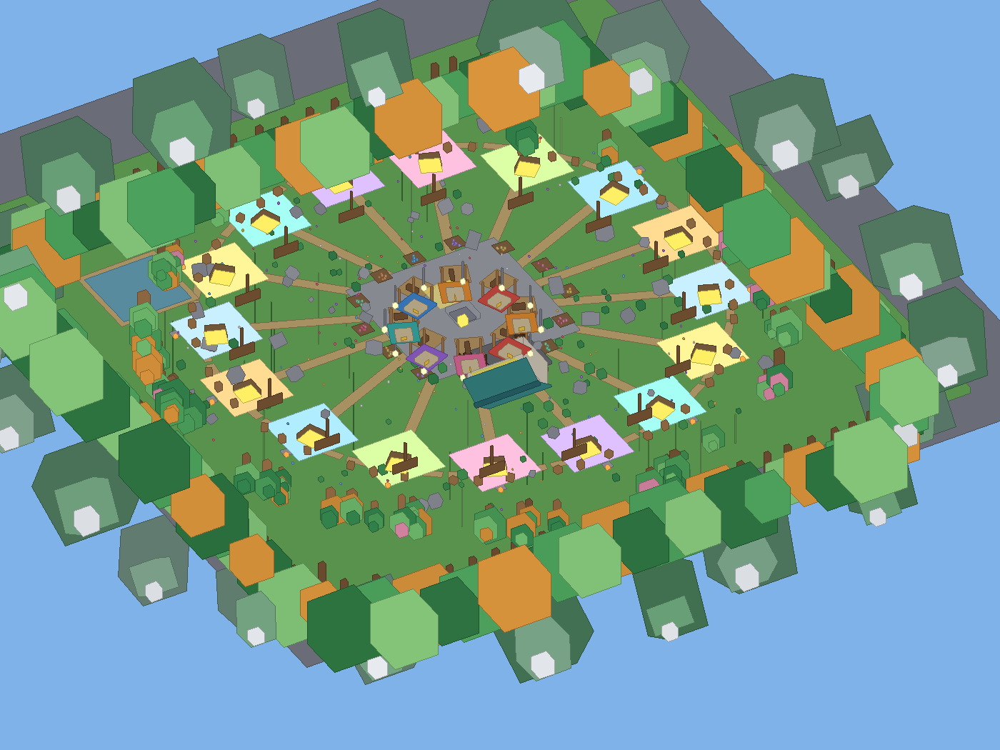

# 🥚 УКРАДИ ЯЙЦО — готовая игра для Roblox

Полноценная игра в стиле популярных «Steal an Egg»: собираешь яйца на рынке,
несёшь на свою базу, они приносят монеты, а другие игроки пытаются их украсть.
Есть магазин улучшений, 4 редкости яиц, сохранение прогресса и таблица лидеров.

**Всё написано кодом.** Ничего не нужно расставлять руками — карта строится сама
при запуске.

---

## ⚡ Запуск за 4 шага

1. Скачай **`EggGame.rbxlx`** из репозитория.
2. **Двойной клик** — откроется Roblox Studio. Мир будет виден **сразу**.
3. `Game Settings` → `Security` → включи **Enable Studio Access to API Services**.
4. Нажми **▶ Play** (F5).

## ❗ Важно про режим редактирования

Ты увидишь мир **сразу при открытии файла** — это статичное превью.

Но **игровая логика работает только в Play**. В режиме редактирования:
- яйца не спавнятся
- монеты не капают
- магазин не открывается
- красть нельзя

Это нормально: Roblox выполняет скрипты только при запуске игры.

Что происходит при нажатии Play:
1. Скрипт удаляет статичное превью
2. Строит живую арену (она чуть отличается: тут яйца, подписи, кнопки)
3. Запускает геймплей

> Превью и живая арена выглядят одинаково — разница только в том,
> что в Play появляются яйца, интерактив и анимации.

### 🗺 Что ты увидишь



Круглая арена 400×400, окружённая живым лесом. Горы — только фон за лесом.

| Зона | Что там |
|---|---|
| **Центр** | Каменная площадь, 8 палаток с разноцветными навесами, вращающаяся статуя-яйцо, гирлянды фонарей, табло лидеров, спавн |
| **Магазин** | На площади у спавна: здание с бирюзовой крышей, витринами и вывеской. Внутри прилавок-касса, 6 полок по улучшениям и NPC-продавец |
| **16 баз** | По кругу. У каждой свой цвет — сразу видно, где чья территория. Склад с золотым свечением, забор, ящики, костёр |
| **Природа** | 50 деревьев (зелёные, осенние, сакура), 14 цветочных клумб, пруд с камышом, камни, кусты, 140 цветов |
| **Край** | Густой лес из 96 деревьев + невидимый барьер |

### 🎵 Музыка

По умолчанию игра **без музыки** — я не могу загрузить звук за тебя,
у каждого файла в Roblox свой ID и выдаёт его только владелец аккаунта.

Включить свою (2 минуты):
1. Открой [roblox.com/create](https://create.roblox.com) → **Audio** → загрузи `.mp3`
2. Скопируй число из ссылки после `?id=`
3. В `EggGameConfig` найди строку и вставь ID:
   ```lua
   Config.MusicId = "rbxassetid://1234567890"
   ```
4. Готово. Второй трек для фона: `Config.AmbientSoundId`

Если ID не задан — в Output появится подсказка, игра просто работает молча.

### 🏠 Как занять базу

У каждой из 16 баз стоит стойка **«🏠 Занять»**:
- Подойди и зажми **E**
- База станет твоей, склады и доход — твои

Подписи на стойках:
| Надпись | Что значит |
|---|---|
| 🏠 Занять | База свободна, можно встать |
| ＋ Подселиться | Уже есть хозяин, но есть место (база на 2) |
| 🔒 Занято | Мест нет |

Сколько человек влезает на базу — `Config.BaseMaxOwners` (по умолчанию 2).

### 🥚 Как добыть яйца (кликер)

Разбросанных яиц на карте больше нет. Вместо них на рынке стоят **6 гнёзд**:

1. Подойди к гнезду
2. Зажми **E** — выбьешь яйцо
3. Кликай подряд — растёт **комбо**, шанс редкого повышается (до +150%)
4. Иногда срабатывает **крит** — сразу x3 к удаче

Дальше как раньше: несёшь яйца на свою базу, они дают монеты в секунду.

### 🎉 Ивенты каждые 2 минуты

Раз в 2 минуты на рынке что-то происходит. За 8 секунд до старта придёт предупреждение.

| Ивент | Что даёт |
|---|---|
| 🌧 Золотой дождь | Эпические и легендарные яйца падают на площадь |
| ☄️ Метеоритный дождь | Легендарные и мифические |
| ✨ Дар богов | Мифические и божественные |
| 🌌 Космический разлом | Божественные и космические (редчайшие) |
| ⚡ Яичная лихорадка | Клик по гнёздам даёт в 3 раза больше |

Яйца ивента светятся — их видно издалека. Подбираются касанием.

### 🥚 Виды яиц (8 штук)

| Яйцо | Шанс | Цена |
|---|---|---|
| Обычное | 5000 | 1 |
| Необычное | 2600 | 3 |
| Редкое | 1400 | 8 |
| Эпическое | 700 | 25 |
| Легендарное | 220 | 90 |
| Мифическое | 60 | 350 |
| Божественное | 15 | 1500 |
| Космическое | 4 | 7500 |

Чем реже — тем ярче светится. Космическое переливается.

### 💎 Донат за Robux

В магазине есть вкладка **«💎 Robux»** — 6 товаров: наборы монет,
мифическое/божественное/космическое яйцо и вечный буст +50% к доходу.

**Чтобы покупки работали**, нужны Developer Product ID:
1. Открой свой опыт на [create.roblox.com](https://create.roblox.com)
2. **Monetization** → **Developer Products** → создай товар
3. Скопируй его **ID**
4. В `EggGameConfig` в `Config.Donations` вставь ID в поле `ProductId`

Пока ID не задан, вкладка честно показывает «⚠ не настроен (нужен ProductId)»
и ничего не ломает.

### 🛒 Как открыть магазин

Два способа:
- **Кнопка в интерфейсе** — «Магазин» справа сверху, или клавиша **B**
- **Стойка у входа в здание магазина** — подойди и зажми **E**

На полках внутри — те же 6 улучшений, что и в панели.

---

## 📦 Способ 2: вручную (если хочешь всё контролировать)

### Что в наборе

| Файл | Куда вставлять | Что это |
|---|---|---|
| `src/ReplicatedStorage/EggGameConfig.lua` | ReplicatedStorage → **ModuleScript** `EggGameConfig` | Все числа баланса |
| `src/ServerScriptService/EggGameMain.server.lua` | ServerScriptService → **Script** `EggGameMain` | Главный серверный скрипт |
| `src/ServerScriptService/EggGame/EggGameMap.lua` | ServerScriptService → **ModuleScript** `EggGameMap` | Генератор карты |
| `src/ServerScriptService/EggGame/EggGameData.lua` | ServerScriptService → **ModuleScript** `EggGameData` | Данные и сохранения |
| `src/ServerScriptService/EggGame/EggGameCore.lua` | ServerScriptService → **ModuleScript** `EggGameCore` | Вся игровая логика |
| `src/StarterPlayer/StarterPlayerScripts/EggGameUI.client.lua` | StarterPlayerScripts → **LocalScript** `EggGameUI` | Интерфейс |

⚠️ **Модули `EggGameMap`, `EggGameData`, `EggGameCore` должны лежать вместе
в одной папке**, потому что они обращаются друг к другу через `script.Parent`.
Создай в `ServerScriptService` папку `EggGame` и положи их туда.

---

### Шаг 1. Создай новый проект

1. Открой **Roblox Studio**.
2. `New` → шаблон **Baseplate**.
3. Удали из `Workspace` стандартный `Baseplate` и `SpawnLocation`
   (их всё равно удалит скрипт, но лучше сделать сразу).

### Шаг 2. Создай структуру в Explorer

В окне **Explorer** (справа) сделай так:

```
ReplicatedStorage
└── EggGameConfig          ← ModuleScript

ServerScriptService
├── EggGameMain            ← Script (обычный, НЕ LocalScript)
└── EggGame                ← Folder
    ├── EggGameMap         ← ModuleScript
    ├── EggGameData        ← ModuleScript
    └── EggGameCore        ← ModuleScript

StarterPlayer
└── StarterPlayerScripts
    └── EggGameUI          ← LocalScript
```

**Как создавать объекты:** правый клик по нужному месту в Explorer →
`Insert Object` → выбери `ModuleScript`, `Script`, `LocalScript` или `Folder`.

> 💡 `Script` в Studio выглядит как кубик с «пьедесталом».
> `LocalScript` — кубик с «окошком». Не перепутай `EggGameMain`!

### Шаг 3. Вставь код

Для каждого файла:

1. Кликни на объект в Explorer.
2. В окне **Code** (сверху) выдели всё: `Ctrl+A` (Mac: `Cmd+A`), удали.
3. Открой соответствующий файл из папки `src` в этом репозитории.
4. Скопируй **весь** текст и вставь в Code.

Порядок не важен, но удобно идти сверху вниз по таблице.

### Шаг 4. Включи сохранение прогресса

Без этого игра работает, но монеты не сохраняются между сессиями.

1. `Home` → **Game Settings** (иконка шестерёнки).
2. Вкладка **Security**.
3. Включи **Enable Studio Access to API Services**.
4. `Save` → перезапусти Studio.

### Шаг 5. Запусти!

Нажми **▶ Play** (F5) или **Play Here**.

Должно произойти:
- Построится арена: рынок в центре с яйцами, 16 баз по кругу.
- Персонаж появится на рынке.
- Слева сверху — монеты, справа — рюкзак и склад.
- Яйца сами запрыгивают в стопку над головой, когда проходишь рядом.

В окне **Output** (`View` → `Output`) должно быть:

```
================================================
[EggGame] Сервер запущен
[EggGame] Баз: 16 | Яиц на рынке: 40
[EggGame] Сохранение: ВКЛЮЧЕНО
================================================
```

---

## 🎮 Как играть

| Действие | Как |
|---|---|
| Собирать яйца | Просто ходи по рынку — яйца подбираются сами |
| Нести на базу | Иди к базе со своим ником над ней (зелёная площадка) |
| Сдать яйца | Заходишь в зону базы — яйца сами уходят на склад |
| Получать монеты | Яйца на складе капают монетами каждую секунду |
| Обокрасть чужой склад | Подойди к чужому складу и **зажми E** |
| Украсть у игрока | Подойди к игроку с яйцами и **зажми E** |
| Магазин улучшений | Кнопка внизу или клавиша **B** |

### 🥚 Типы яиц

| Яйцо | Шанс | Цена | Сколько дохода |
|---|---|---|---|
| ⚪ Обычное | 70% | 1 | базовое |
| 🔵 Редкое | 20% | 5 | ×5 |
| 🟣 Эпическое | 8% | 20 | ×20 |
| 🟡 Легендарное | 2% | 100 | ×100 |

Дорогие яйца светятся — их видно издалека и за них идёт основная борьба.

### 🛒 Улучшения

| Улучшение | Что даёт |
|---|---|
| 🎒 Рюкзак | Больше яиц влезает за спину |
| ⚡ Скорость | Быстрее бегаешь (с грузом медленнее) |
| 🧲 Магнит | Яйца подбираются с большего расстояния |
| 🥷 Ловкость | За одну кражу уносишь больше яиц |
| 🏦 Склад | Больше яиц помещается на базе |
| 💎 Доход | Каждое яйцо приносит больше монет |

---

## 🎛 Как менять игру

**Всё в одном файле** — `ReplicatedStorage.EggGameConfig`.

### Хочу, чтобы доход был быстрее
```lua
Config.IncomeRate = 0.14   -- было 0.14, поставь 0.3 или 0.5
```

### Хочу больше баз
```lua
Config.BasesCount = 24     -- было 16
Config.BaseRingRadius = 130 -- и увеличь радиус круга, чтобы не теснились
Config.ArenaSize = 400      -- и саму арену
```

### Хочу редкие яйца чаще
```lua
-- в Config.EggTypes.Legendary
Weight = 2,   -- поставь 6, и легендарки будут падать втрое чаще
```

### Хочу изменить цены улучшений
```lua
-- например, рюкзак
Backpack = {
    BaseCost = 25,      -- цена первого уровня
    CostGrowth = 1.55,  -- во сколько раз дорожает каждый следующий
    MaxLevel = 10,      -- максимум уровней
    BaseValue = 3,      -- на 1 уровне
    PerLevel = 2,       -- прибавка за уровень
},
```

### Хочу, чтобы вор не мог унести всё сразу
```lua
Config.StealCooldown = 1.5   -- пауза между кражами (сек)
Config.StealLockTime = 2.5   -- сколько яйцо «прилипает» после подбора
```

> После правок нажми `Stop` и снова `Play` — изменения применятся.

---

## 🌐 Как выложить в Roblox

1. `File` → **Publish to Roblox As...**
2. Придумай название (например, `Steal an Egg 🥚`).
3. В настройках игры (`Game Settings` → `Permissions`) поставь **Public**.
4. В `Game Settings` → `Security` убедись, что API Services включены —
   иначе сохранения не будут работать у игроков.

### Что стоит добавить перед публикацией
- 🖼 **Иконку и миниатюры** — без них игру почти не открывают. Рисуй в любом
  редакторе: яркое яйцо + крупный текст.
- 🎵 **Музыку** — вставь `Sound` в `SoundService`, выбери из библиотеки Roblox.
- 📝 **Описание** — напиши, что нужно делать: «Собирай яйца, неси на базу,
  обкрадывай других!»
- 🧪 **Протестируй в `Test` → `Start Server` с 2–3 игроками**, чтобы проверить
  кражи между игроками (в обычном Play ты один).

---

## 🧪 Тест кражи в одиночку

Чтобы проверить механику кражи, нужен второй игрок:

1. В Studio: вкладка **Test** → **Clients and Servers** → выбери **3 players**.
2. Нажми **Start**.
3. Откроется несколько окон — в одном собери яйца и встань рядом с другим.

---

## 🔬 Как проверялся код

Я не могу запустить Roblox Studio, поэтому сделал собственные инструменты
проверки — вплоть до **полной симуляции игры** на настоящем Luau-движке
(том же языке, что в Roblox) с заглушкой Roblox API.

```bash
node tools/check-luau.mjs     # компиляция настоящим Luau
node tools/sim/run.mjs        # полный запуск игры без Studio
```

Симуляция проверяет:
- игра запускается без ошибок
- карта строится: пол, 16 баз, рынок, деревья
- SpawnLocation создан (персонаж не падает)
- все 7 RemoteEvent/Function на месте
- сбор яиц и лимит рюкзака
- кражу (защита сразу после подбора + успешная кража после)
- покупку улучшений и отказ при нехватке денег
- доход базы

Последний прогон: **все 6 проверок механик пройдены.**

> ⚠️ Симуляция не заменяет реальный Studio: физика, рендер и DataStore
> в ней упрощены. Но логику и структуру она проверяет честно.

---

## 🐛 Если что-то не работает

**Ошибка «EggGameConfig не найден»**
→ Модуль лежит не в `ReplicatedStorage` или назван иначе.
Имя должно быть точно `EggGameConfig` (без `.lua`).

**Ошибка «Не найден модуль EggGameMap»**
→ Скрипт сам ищет модули в трёх местах (в папке `EggGame`, рядом с собой,
и где угодно в `ServerScriptService`). Если всё равно не нашёл — проверь,
что модули вообще вставлены и названы точно (`EggGameMap`, `EggGameData`,
`EggGameCore`), без `.lua` в имени.

**Карта не строится, в Output пусто**
→ `EggGameMain` создан как `LocalScript` вместо `Script`.
Проверь тип объекта в Explorer.

**Ничего не видно, но ошибок нет**
→ Ты смотришь не туда. Карта в `Workspace` → `EggGame`.
Камера должна быть рядом с персонажем.

**Монеты не сохраняются**
→ `Game Settings` → `Security` → **Enable Studio Access to API Services**.
В Output будет строка «Сохранение: ВЫКЛЮЧЕНО».

**Интерфейс не появляется**
→ `EggGameUI` должен быть именно `LocalScript` в `StarterPlayerScripts`,
а не в `ReplicatedStorage` или `ServerScriptService`.

**Яйца не подбираются**
→ Проверь, что ты не стоишь на своей базе (там они сразу уходят в склад)
и что рюкзак не заполнен.

**Игра тормозит на телефонах**
→ Уменьши `Config.MaxGroundEggs` (например, до 20)
и `Config.MaxVisibleStack` (до 9).

---

## 🔍 Как это устроено (если захочется разобраться)

```
Клиент (EggGameUI)                Сервер (EggGameMain)
      │                                  │
      │  ← Notify / CoinsUpdate ─────────┤  уведомления, монеты
      │  ← ShopUpdate / BaseInfo ────────┤  магазин, склад
      │                                  │
      │  ── BuyUpgrade ────────────────→ │  покупка улучшения
      │  ── GetShop ───────────────────→ │  запрос магазина
      │                                  │
                              ┌──────────┴──────────┐
                              │   EggGameCore       │
                              │  яйца, кражи, доход │
                              └──────────┬──────────┘
                                         │
                    ┌────────────────────┼────────────────────┐
                    │                    │                    │
              EggGameMap           EggGameData         EggGameConfig
              строит карту         сохранения          числа баланса
```

**Почему всё на сервере:** клиент не может «нарисовать» себе монеты или яйца.
Он только просит сервер, а сервер проверяет расстояние, кулдаун, вместимость
рюкзака и только потом выдаёт награду. Так игру не сломать читами.

---

## 🛠 Инструменты проверки (для разработчика)

В папке `tools` есть самопроверки кода — их удобно запускать после правок,
чтобы поймать опечатки до открытия Studio.

```bash
npm install          # один раз: поставит luaparse
./tools/check-all.sh # проверит синтаксис, свойства Roblox и порядок объявлений
node tools/build-rbxlx.js  # пересобрать EggGame.rbxlx после правок в src/
```

| Инструмент | Что проверяет |
|---|---|
| `check-syntax.js` | Ошибки синтаксиса Luau (лишние `end`, скобки, строки) |
| `check-properties.js` | Существуют ли использованные свойства Roblox |
| `check-globals.js` | Опечатки в именах переменных |
| `check-order.js` | Вызовы функций до их объявления |
| `build-rbxlx.js` | Собирает `EggGame.rbxlx` из `src/` |

> ⚠️ После правок в `src/` не забудь пересобрать `.rbxlx`, иначе файл
> останется со старым кодом.

---

## 📋 Чек-лист перед публикацией

- [ ] Все 6 объектов созданы и в них вставлен код
- [ ] `EggGameMain` — это `Script`, а не LocalScript
- [ ] Модули лежат в одной папке `EggGame`
- [ ] API Services включены
- [ ] Протестировал с 2–3 «игроками» в Test
- [ ] Проверил, что кража склада и кража у игрока работают
- [ ] Поменял `Config` под свой вкус
- [ ] Добавил иконку, описание, музыку
- [ ] Опубликовал и поставил Public

Удачи! 🥚 Если что-то не заведётся — пришли текст ошибки из Output, разберёмся.
